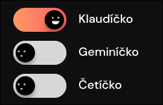

# Klaudíčko

> **Klaudíčko** je rozšíření pro Firefox, které na stránkách AI asistentů přepíše jejich názvy na české zdrobněliny: Claude na Klaudíčko, Gemini na Geminíčko a ChatGPT na Četíčko. Které z nich chceš počeštit, si zapneš přepínači v okně rozšíření.

## Jak používat

1. Klikni na ikonu Klaudíčka  v liště prohlížeče (pokud ji nevidíš, najdeš ji pod ikonou skládačky 🧩)
2. Přepínačem zapni AI, které chceš počeštit
3. Obnov stránku (F5 nebo CTRL+R) a název se změní

## Licence

Klaudíčko je volné dílo uvolněné do veřejné domény pod licencí [Unlicense](https://unlicense.org/). Můžeš ho kopírovat, upravovat, šířit i prodávat, bez jakýchkoliv podmínek.